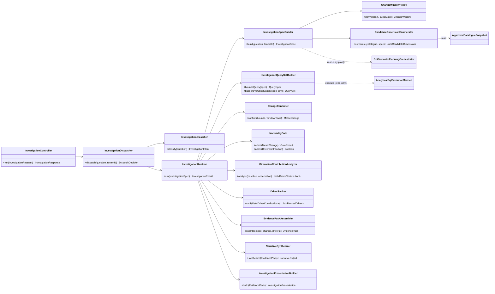
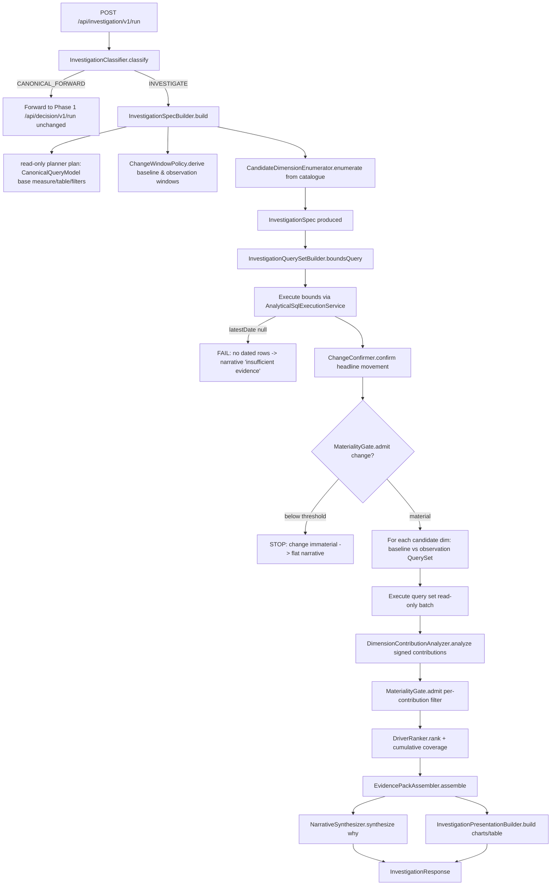

# Investigation Runtime V1 — Technical Design Document

> **Status:** Design only. Phase 1 is production-locked. No Phase 1 code, schema, planner,
> `execution_mode`, or routing logic is modified by this design. Phase 2 is a sibling runtime.

---

## 0. Design Constraints (binding)

- Phase 1 (`DecisionRuntime`, `GptSemanticPlanningOrchestrator`, `StructuredSemanticPlan`, `GptPlanningOutcome`, `execution_mode`, all planner prompts, all routing) is **production-locked and read-only**.
- Phase 2 is a **sibling runtime** with its own entry point. It never edits, wraps, or re-routes the canonical path.
- Phase 2 may **call Phase 1 components read-only** (e.g. invoke the planner to obtain a `CanonicalQueryModel`, reuse `AnalyticalSqlExecutionService`), but never mutate them.
- No dependency is injected *from* Phase 2 *into* any Phase 1 class. The dependency arrow points one way: Phase 2 → Phase 1.

---

## A. Exact Class Diagram



**Ownership rule:** every solid arrow is a Phase-2→Phase-2 dependency. Every dashed arrow is a Phase-2→Phase-1 **read-only** call. No arrow originates in Phase 1.

---

## B. Exact Package Structure

```
com.example.BACKEND.catalogue.investigation        (NEW root — fully isolated from decision.runtime)
├── api
│   ├── InvestigationController.java                // POST /api/investigation/v1/run
│   ├── InvestigationRequest.java                   // {question, tenantId}
│   └── InvestigationResponse.java                  // presentation + narrative + evidence
├── dispatch
│   ├── InvestigationDispatcher.java                // decides canonical-forward vs investigate
│   ├── InvestigationClassifier.java                // independent intent classifier (NOT planner)
│   ├── InvestigationIntent.java                    // enum: CANONICAL_FORWARD | INVESTIGATE
│   └── DispatchDecision.java
├── runtime
│   └── InvestigationRuntime.java                   // orchestrator (sibling of DecisionRuntime)
├── spec
│   ├── InvestigationSpecBuilder.java
│   ├── InvestigationSpec.java
│   ├── CandidateDimension.java
│   └── CandidateDimensionEnumerator.java
├── window
│   ├── ChangeWindowPolicy.java
│   ├── ChangeWindow.java
│   └── TimeWindow.java
├── query
│   └── InvestigationQuerySetBuilder.java
├── change
│   ├── ChangeConfirmer.java
│   └── MetricChange.java
├── materiality
│   ├── MaterialityGate.java
│   └── GateResult.java
├── contribution
│   ├── DimensionContributionAnalyzer.java
│   ├── DriverContribution.java
│   ├── DriverRanker.java
│   └── RankedDriver.java
├── evidence
│   ├── EvidencePackAssembler.java
│   └── EvidencePack.java
├── narrative
│   ├── NarrativeSynthesizer.java
│   └── NarrativeOutput.java
├── presentation
│   ├── InvestigationPresentationBuilder.java
│   └── InvestigationPresentation.java
└── config
    └── InvestigationProperties.java                // kontexa.investigation.*
```

This root does **not** live under `catalogue.decision.runtime`; it is a peer tree, so no Phase-1 package is reopened.

---

## C. Exact Execution Flow



**Key property:** the only path back into Phase 1 is the `CANONICAL_FORWARD` branch (a plain HTTP/service forward, no shared mutable state) and read-only calls (planner `plan()`, SQL execution). The canonical `DecisionRuntime` never learns Phase 2 exists.

---

## D. InvestigationSpec Contract

| Field | Type | Meaning |
|---|---|---|
| `question` | string | Original user question (verbatim) |
| `tenantId` | string | Tenant/workspace identifier |
| `applicable` | boolean | False => short-circuit to not-applicable narrative |
| `notApplicableReason` | string? | Populated only when `applicable=false` |
| `metricColumn` | string | Base measure (from read-only `CanonicalQueryModel.measure`) |
| `metricLabel` | string | Display label |
| `aggregation` | enum `SUM`/`COUNT` | V1 supports additive only |
| `tableRef` | string | Fully-qualified warehouse table |
| `baseFilters` | list⟨Filter⟩ | Inherited filters (e.g. `airport_flag = true`) |
| `direction` | enum `INCREASE`/`DECREASE`/`ANY` | Hypothesized movement (V1 = `ANY`) |
| `timeColumn` | string | Date/timestamp column for windowing |
| `grain` | enum `DAY`/`WEEK`/`MONTH` | Window grain |
| `window` | `ChangeWindow` | Baseline + observation ranges (see H) |
| `candidateDimensions` | list⟨`CandidateDimension`⟩ | Eligible decomposition dimensions |

```jsonc
// CandidateDimension
{ "column": "route", "label": "Route", "eligibilityReason": "low-cardinality categorical" }
```

`InvestigationSpec.notApplicable(question, reason)` is the canonical empty form used by every guard.

---

## E. EvidencePack Contract

Auditable bundle handed to the narrative synthesizer. Every number is traceable to a query.

```jsonc
{
  "investigation": {
    "question": "Why did revenue decline?",
    "metricLabel": "Revenue",
    "aggregation": "SUM",
    "direction": "DECREASE"
  },
  "change": {
    "baselineValue": 1250000.0,
    "observationValue": 1090000.0,
    "absoluteDelta": -160000.0,
    "percentDelta": -12.8,
    "classification": "DECREASE",
    "material": true
  },
  "window": {
    "baseline":    { "startInclusive": "2026-04-01", "endExclusive": "2026-05-01" },
    "observation": { "startInclusive": "2026-05-01", "endExclusive": "2026-06-01" },
    "grain": "MONTH"
  },
  "rankedDrivers": [
    {
      "rank": 1,
      "dimension": "route",
      "member": "JFK->LAX",
      "baselineValue": 320000.0,
      "observationValue": 210000.0,
      "signedContribution": -110000.0,
      "contributionPctOfDelta": 68.75,
      "cumulativeCoveragePct": 68.75
    }
  ],
  "coverage": {
    "explainedPctOfDelta": 91.2,
    "residualPctOfDelta": 8.8,
    "driversConsidered": 24,
    "driversReported": 5
  },
  "provenance": {
    "boundsQueryId": "q-bounds-001",
    "perDimensionQueryIds": { "route": "q-route-002" },
    "tableRef": "project.dataset.rides",
    "baseFilters": [ { "column": "airport_flag", "operator": "=", "value": "true" } ]
  },
  "confidence": {
    "level": "MODERATE",
    "reasons": ["material change confirmed", "coverage >= 80%"]
  }
}
```

**Contract invariants:** (1) `sum(signedContribution) ± residual == absoluteDelta`; (2) every `rankedDriver` and `change` value maps to a `provenance` query id; (3) the synthesizer may only reference facts present in the pack.

---

## F. DriverContribution Contract

Pre-ranking, per dimension member.

| Field | Type | Meaning |
|---|---|---|
| `dimension` | string | Dimension column |
| `member` | string | Member value (e.g. `"JFK->LAX"`) |
| `baselineValue` | double | Metric in baseline window |
| `observationValue` | double | Metric in observation window |
| `signedContribution` | double | `observationValue - baselineValue` |
| `contributionPctOfDelta` | double | `signedContribution / headlineDelta * 100` |
| `aligned` | boolean | True if sign matches headline `direction` |

`RankedDriver` wraps it: `{ rank:int, contribution:DriverContribution, cumulativeCoveragePct:double }`.

Decomposition is **additive** in V1: contribution = simple windowed delta of the additive measure per member. No LMDI, no multiplicative metric decomposition.

---

## G. Materiality Gate Design

Two-stage gate; both thresholds from `InvestigationProperties`.

**Stage 1 — Headline gate (`admit(MetricChange)`):**
- Inputs: `absoluteDelta`, `percentDelta`, baseline magnitude.
- Admit if `abs(percentDelta) >= kontexa.investigation.materiality-threshold-pct` (default 2.0) **AND** baseline magnitude > 0.
- Reject => runtime stops with a "no material movement" narrative (not an error).

**Stage 2 — Driver gate (`admit(DriverContribution)`):**
- Drop members whose `abs(contributionPctOfDelta)` < per-driver floor (default 1.0%), preventing long-tail noise.
- Survivors flow to the ranker; dropped mass is folded into `residualPctOfDelta`.

**Purpose:** guarantees Phase 2 never narrates noise as a "driver," and bounds reported drivers to `top-drivers-in-pack` (default 10) regardless of cardinality.

---

## H. ChangeWindow Policy Design

`ChangeWindowPolicy.derive(timeColumn, grain, latestDate) -> ChangeWindow`

- **Anchor:** `latestDate` comes from the bounds query (`MAX(timeColumn)` with `baseFilters`). If null => failure F1 below.
- **Half-open ranges** to avoid boundary double counting:
  - `observation = [latestDate - 1 grain, latestDate + 1 day)` truncated to grain start.
  - `baseline    = [latestDate - 2 grains, latestDate - 1 grain)`.
- **Grain selection:** explicit spec grain if provided; else default `kontexa.investigation.window.default-grain` (`MONTH`).
- **Output:** `ChangeWindow{ baseline:TimeWindow, observation:TimeWindow, grain }` where `TimeWindow{ column, startInclusive, endExclusive }` renders to SQL date literals.
- **Comparability rule:** baseline and observation must be equal-length, contiguous, non-overlapping. The policy is the single source of truth — analyzers never compute their own dates.

---

## I. Failure Scenarios

| ID | Condition | Detection point | Behavior (graceful, never 500) |
|---|---|---|---|
| F1 | No dated rows (`latestDate == null`) | After bounds query | Narrative: "No dated rows available to establish a comparison window." Empty evidence. |
| F2 | Change immaterial (Stage-1 gate fails) | `MaterialityGate.admit(change)` | Narrative: "Metric was effectively flat (delta X%)." No driver analysis. |
| F3 | No eligible candidate dimensions | `CandidateDimensionEnumerator` returns empty | Narrative: headline change only, "no decomposable dimensions in catalogue." |
| F4 | All drivers below Stage-2 floor | After contribution analysis | Report headline + residual=100%; "movement is broadly distributed, no single driver." |
| F5 | Warehouse query error / timeout | During read-only batch execution | Narrative: "Evidence could not be retrieved." Provenance records failed query id. |
| F6 | Non-additive metric requested | `InvestigationSpecBuilder` | `notApplicable` => **forward to Phase 1 canonical** (out of V1 scope). |
| F7 | Classifier ambiguity | `InvestigationClassifier` | Default to `CANONICAL_FORWARD` (fail-safe toward Phase 1). |
| F8 | Coverage < threshold but drivers exist | After ranking | Still return pack; `confidence.level = LOW`; narrative flags low coverage. |

Guiding principle: **every failure degrades to a narrative + empty/partial EvidencePack, and ambiguity always falls back to Phase 1.**

---

## J. How Phase 1 and Phase 2 Coexist in One Chatbox (No Interference)

**Entry separation.** The chatbox calls a single new endpoint `POST /api/investigation/v1/run`. This endpoint is owned entirely by Phase 2 and does not exist in Phase 1. The canonical endpoint `/api/decision/v1/run` is **unchanged and still directly callable**.

**Independent classification (not `execution_mode`).** `InvestigationClassifier` is a Phase-2-only component. It does **not** read, import, or depend on the planner's `execution_mode`, `StructuredSemanticPlan`, or `GptPlanningOutcome`. It performs its own lightweight intent check (causal/explanatory vs. retrieval). This keeps the locked planner contract untouched.

**Dispatch, not re-routing:**
- `CANONICAL_FORWARD` => the dispatcher forwards the request to the existing `/api/decision/v1/run` (or the existing decision service bean called read-only). Phase 1 executes exactly as today, byte-for-byte. Phase 2 adds nothing to its trace, response, or banner.
- `INVESTIGATE` => `InvestigationRuntime` runs and returns an `InvestigationResponse` with its **own** presentation/trace shape, clearly tagged `runtime: "investigation"`.

**No shared mutable state.** Phase 2 never writes to `runRegistry`, `diagnosticSession.warehouseFacts`, the canonical trace, or any Phase-1 singleton. It maintains its own result/trace objects. Therefore a Phase-2 run can never corrupt the canonical debug panel (the `PLANNER: LEGACY / (none)` artifact is structurally impossible here, because canonical questions are forwarded untouched and investigation responses use a distinct schema).

**Banner integrity.** The GPT-planner banner depends only on `/api/decision/v1/planner/status`. Phase 2 does not touch that endpoint or its auth. The banner reflects Phase-1 planner mode regardless of investigation activity.

**Frontend contract.** The chat UI inspects the response's `runtime` tag: `canonical` renders the existing executive card/charts/SQL panel; `investigation` renders the EvidencePack-driven driver view. The two never share a rendering branch, so neither can blank out the other.

**One-way dependency guarantee (the coexistence invariant):**

```
Phase 2  --reads-->  Phase 1   (allowed: planner.plan(), SQL execution, catalogue read, canonical forward)
Phase 1  --/X/-->    Phase 2   (forbidden: no Phase-1 class imports, injects, or calls Phase 2)
```

As long as this arrow stays one-directional, Phase 1 remains production-locked and Phase 2 is fully removable by deleting its package tree and the one new controller route — with zero impact on canonical behavior.

---

*Design only. No code written, no Phase 1 files modified, no schema/planner/execution_mode changes.*
